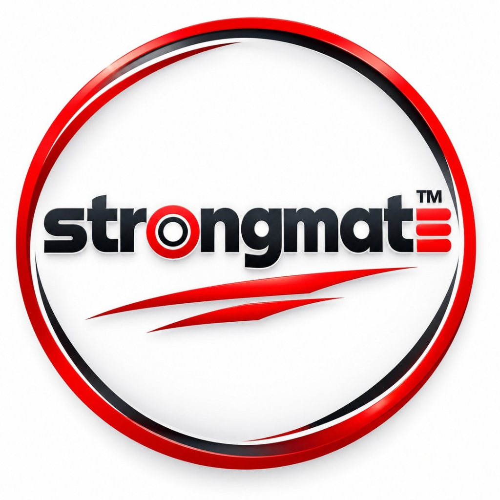
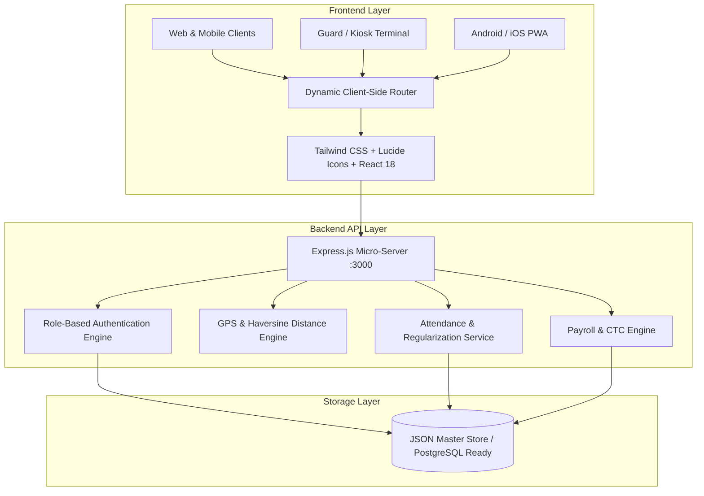

# STRONGMATE™ - Enterprise Workforce, Daily Attendance & HRMS Platform

<p align="center">
  
</p>

<p align="center">
  <b>A Production-Grade, Full-Stack Daily Attendance, Location Intelligence & HR Management System</b>
</p>

<p align="center">
  <a href="#key-features">Key Features</a> •
  <a href="#system-architecture">System Architecture</a> •
  <a href="#portals--access">Portals</a> •
  <a href="#quick-start">Quick Start</a> •
  <a href="#api-reference">API Overview</a> •
  <a href="#deployment">Deployment</a>
</p>

---

## 📌 Executive Summary

**STRONGMATE™** is an enterprise-level workforce and daily attendance management suite designed for businesses, multi-branch offices, gyms, healthcare facilities, field sales operations, and corporate firms. It solves standard biometric and manual attendance hurdles through **GPS-based geofenced tracking, on-site face/kiosk punch-in, real-time live location monitoring, shift scheduling, automated leave accrual, and one-click payroll calculation**.

---

## 🚀 Key Features

### 🏢 1. Multi-Portal Authentication & Access Control
- **Company / Admin Portal**: Complete organizational control, live employee monitoring, CTC setup, master data configuration, and granular analytics.
- **Employee Portal**: Self-service desk for check-in/out, GPS breadcrumb history, break tracking, leave requests, regularization, and payslip downloads.
- **Attendance Kiosk (Guard Desk)**: High-speed tablet/gate check-in interface with photo capture and PIN verification for front-desk security staff.

### 📍 2. Location Intelligence & Field Force Monitoring
- Real-time GPS geofencing around branch offices and work hubs.
- Live employee route replay and breadcrumb timeline.
- Proximity radius checking with automated violation alerts.

### ⏱️ 3. Smart Daily Attendance & Break Tracking
- Automated late-in, early-out, half-day, and overtime (OT) tracking.
- Configurable multiple break types (Tea, Lunch, Smoking, Official Duty).
- Auto-end break alerts and unattended shift mitigation.

### 🌴 4. Comprehensive Leave & Regularization Engine
- Multi-tier leave categories (Casual, Sick, Earned, Maternity, Compensatory).
- Automated leave accrual cycles and balance deduction.
- Sandwich leave policy enforcement and regularization approval workflow.

### 💰 5. Automated Payroll & CTC Management
- Automated salary generation factoring daily attendance, approved leaves, and overtime.
- Fixed and variable pay components, pre-payroll deductions, and allowances.
- Instant payslip generation and download.

### 📱 6. Mobile & PWA Ready
- Native installable Android APK support powered by Capacitor architecture.
- Progressive Web App (PWA) with offline-first service workers and cache management.

---

## 🏗️ System Architecture



---

## 🔐 Portals & Default Credentials

| Portal | URL Route | Target Users | Default Credentials |
| :--- | :--- | :--- | :--- |
| **Admin & HR Portal** | `/login/company` | HR Directors, Operations & Admins | `admin@strongmate.in` / `admin123` |
| **Employee Self-Service** | `/login/employee` | Office & Field Staff | `employee@strongmate.in` / `employee123` |
| **Attendance Kiosk** | `/login/attendance-guard` | Security Desk, Tablet Terminals | `guard@strongmate.in` / `guard123` |

---

## 💻 Tech Stack

- **Frontend**: React 18, Tailwind CSS, Lucide Icons, Nuqs, Rolldown / Vite runtime.
- **Backend**: Node.js, Express.js (245+ REST endpoints).
- **Location Services**: Geolocation API, Haversine formula distance verification.
- **PWA & Mobile**: Web App Manifest, Service Workers, Capacitor Android Bridge.
- **Containerization**: Docker, Docker Compose ready.

---

## ⚡ Quick Start

### Prerequisites
- Node.js (v18 or higher)
- npm or yarn

### Installation

1. **Clone the repository:**
   ```bash
   git clone https://github.com/niharranjanbiswal22-source/Daily-Attendance-.git
   cd Daily-Attendance-
   ```

2. **Install dependencies:**
   ```bash
   npm install
   ```

3. **Start the server:**
   ```bash
   npm start
   ```

4. **Access the application:**
   - Web App & Landing Page: `http://localhost:3000`
   - Company Admin Portal: `http://localhost:3000/login/company`
   - Employee Portal: `http://localhost:3000/login/employee`
   - Kiosk Portal: `http://localhost:3000/login/attendance-guard`

---

## 🐳 Docker Deployment

Run with a single Docker command:

```bash
docker build -t strongmate-attendance .
docker run -d -p 3000:3000 --name strongmate-app strongmate-attendance
```

---

## 🌐 Cloud Deployment Guide (Free Tier)

### Deploying to Render / Railway:
1. Connect this GitHub repository to [Render](https://render.com) or [Railway](https://railway.app).
2. Choose **Web Service** with the following settings:
   - **Environment**: `Node`
   - **Build Command**: `npm install`
   - **Start Command**: `npm start`
3. Click **Deploy**. Your app is live with free HTTPS within 2 minutes!

---

## 📄 License
This project is proprietary and built for enterprise workforce management by **STRONGMATE Technologies Pvt Ltd**.
